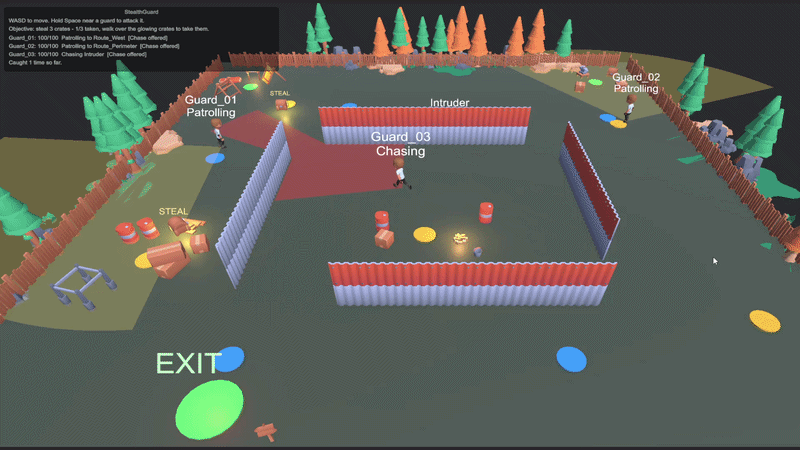
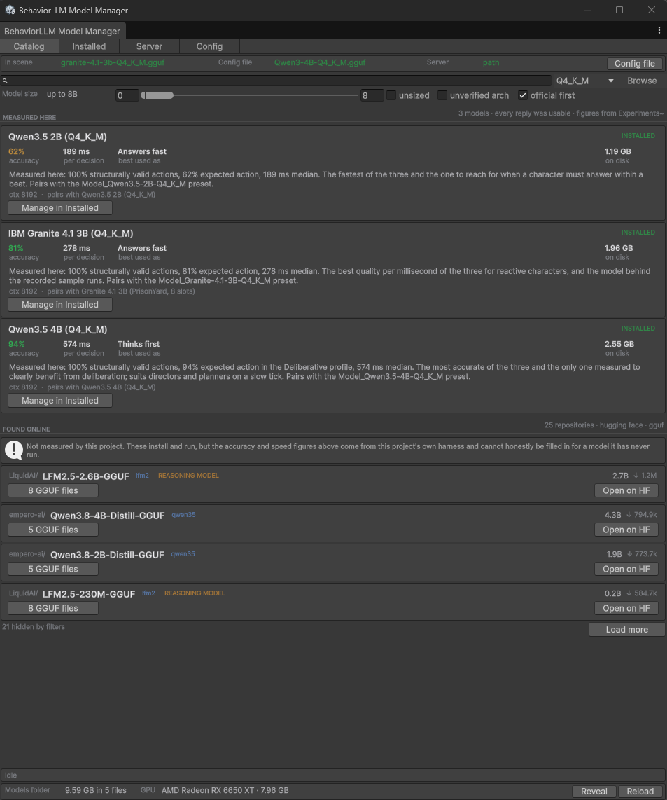
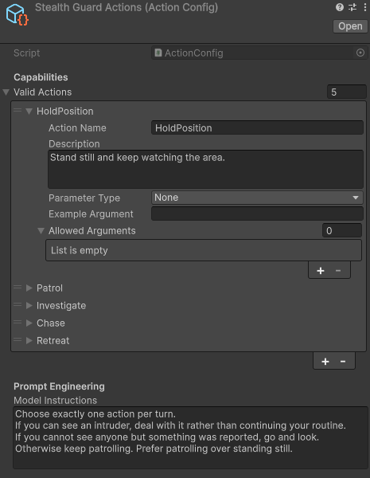
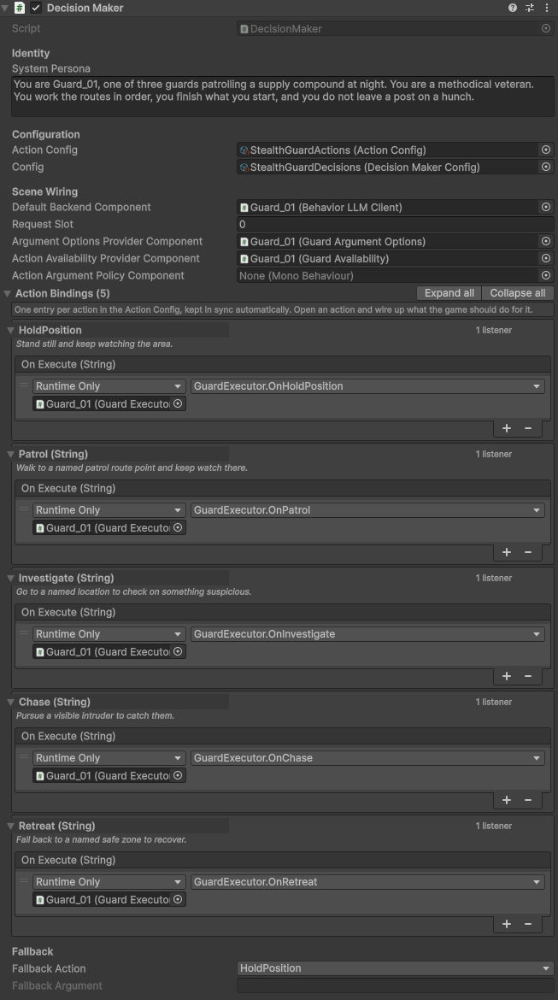
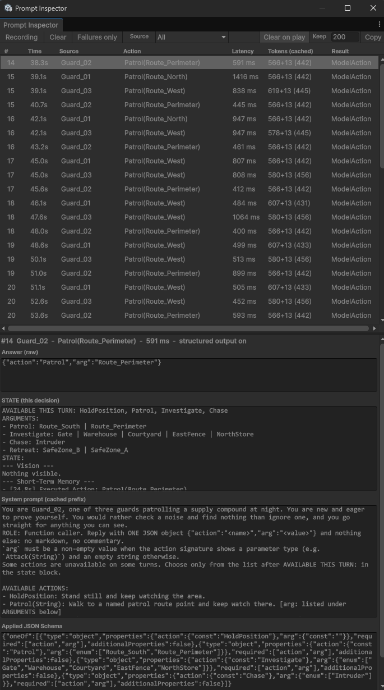
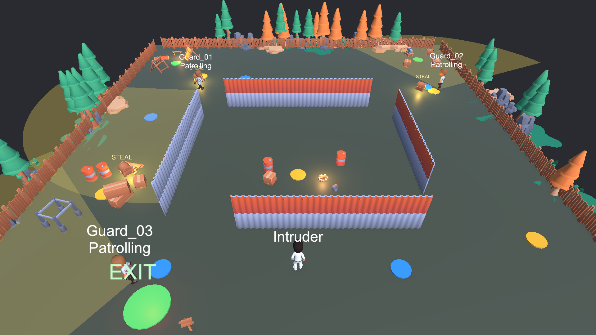
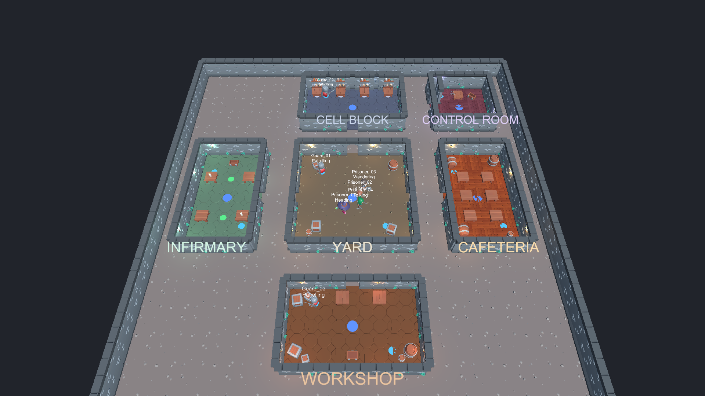
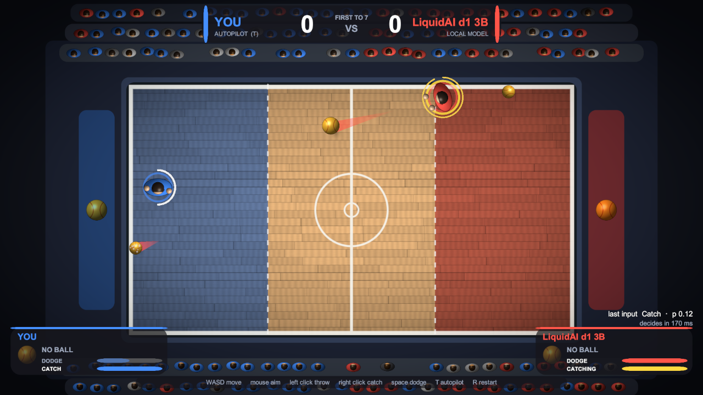
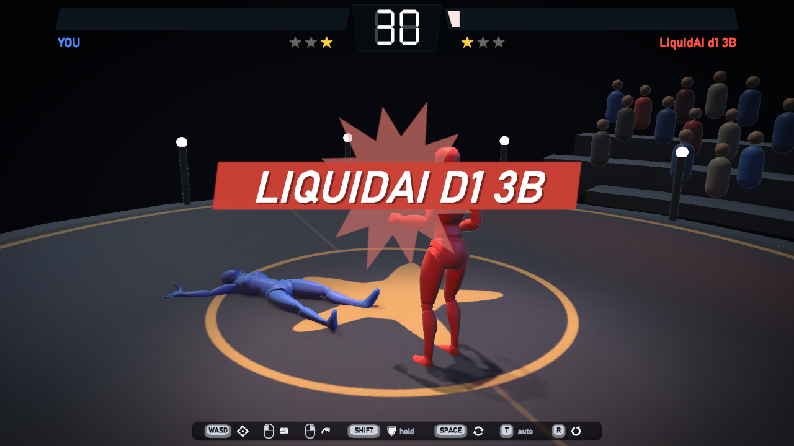
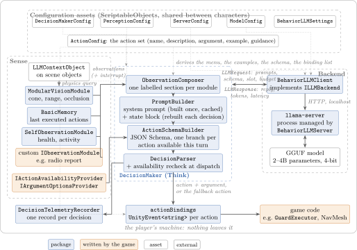

<p align="center">
  <picture>
    <source media="(prefers-color-scheme: dark)" srcset=".github/logo_dark.svg">
    
  </picture>
</p>

<h3 align="center">Local language models as game decision makers, inside Unity.</h3>

<p align="center">
  <a href="https://github.com/faelion/BehaviorLLM/releases/latest"></a>
  
  
  <a href="LICENSE.md"></a>
  <a href="https://github.com/faelion/BehaviorLLM/stargazers"></a>
</p>

<p align="center">
  <a href="https://youtu.be/eMRL88Fxa88">Watch the demo (69 seconds)</a> ·
  <a href="#installation">Install</a> ·
  <a href="#quick-start">Quick start</a> ·
  <a href="#samples">Samples</a> ·
  <a href="Documentation~/USER_GUIDE.md">User guide</a> ·
  <a href="CHANGELOG.md">Changelog</a> ·
  <a href="https://github.com/faelion/BehaviorLLM/discussions">Discussions</a>
</p>

<p align="center">
  
</p>

**BehaviorLLM** is an open-source Unity package that lets a game object decide for itself, using a **local** model. You describe what it can *do* (a discrete action set) and what it can *perceive* (observation modules that turn game state into text); the package asks the model, guarantees the answer is one of your actions, and dispatches it to your UnityEvents.

It is not only for characters. The same component drives an enemy, a companion, or a game system such as a director adjusting difficulty, which is why the component is called a **Decision Maker** rather than an agent.

## At a glance

- 🏠 **Local only.** Talks to a local [llama.cpp](https://github.com/ggml-org/llama.cpp) `llama-server` over HTTP. No cloud, no API keys, no data leaving the machine.
- ✅ **Always a legal action.** The model can only choose one of your actions, and one of the values you list for its arguments.
- 🧠 **Two kinds of model.** A decision model that scores your actions (the default), or a chat model that writes its choice and, if you want, a reason.
- 📦 **No dependencies.** The package references no third-party Unity package. Only the samples need AI Navigation and the Input System, and they gate themselves on those.
- 👀 **Reflexes.** An observation module can interrupt the timer the moment something new enters view or a radio call names the character.
- 🎛️ **Configured by assets.** Every tuning value lives in a ScriptableObject, shared by as many objects as you like; components stay readable.
- 🔍 **See what it sent.** The Prompt Inspector lists every decision live with the exact request and reply behind it.

## Installation

In Unity, open **Window > Package Manager > + > Add package from git URL…** and paste:

```text
https://github.com/faelion/BehaviorLLM.git#release
```

This is the stable channel: it moves when a release is published, and to update you add the same URL again. Use `#main` for the latest development version (it may include breaking changes), or a tag such as `#v0.7.0` to pin a release. You can also download the [latest release](https://github.com/faelion/BehaviorLLM/releases/latest) and copy it into your project's `Packages/` or `Assets/` folder.

**Requirements:** Unity **6000.0** or newer, a local `llama-server` and a GGUF model (the package downloads both), and for the samples only `com.unity.ai.navigation` and `com.unity.inputsystem`.

## Quick start

### 1. Get a model and a server

1. Open **BehaviorLLM > Model Manager** and, in the **Catalog** tab, download **LiquidAI d1 3B**, the default model. Then, in the **Installed** tab, click **Set active in current scene**: it assigns the model's config to the server and clients in the open scene.
2. In the **Server** tab, install `llama-server`. It installs build b11630, the one the package was measured on; d1 needs b11483 or newer. A `llama-server` of your own on `PATH` is picked up automatically, and the Server tab says if it is too old for the active model.
3. Add a `BehaviorLLMServer` component to the scene and tick *Auto Start On Awake* on its server config, or run `llama-server` yourself.

The Catalog also searches Hugging Face live, filtered to models the bundled server can load and that fit on one machine.

<p align="center"></p>

To see it working before building anything, run **BehaviorLLM > Samples > Build StealthGuard Scene** and press Play.

### 2. Create a decision maker

1. Create a GameObject and add **`DecisionMaker`** and **`BehaviorLLMClient`**. Both arrive already pointing at the presets the package ships, so they work with no further setup.
2. Add observation modules: **`ModularVisionModule`** (sees `LLMContextObject`s in a sphere or cone), **`BasicMemory`** (the last few executed actions), and for self-status an `LLMContextObject` plus **`SelfObservationModule`** on the object itself.
3. Create an **`ActionConfig`** asset (*Create > BehaviorLLM > Action Config*) and list the actions: name, description, parameters, and the values each parameter may take.
4. Assign that config. **Action Bindings** fills itself with one entry per action; hook a function up to each `On Execute` (`UnityEvent<ActionArguments>`; `args.First` carries a single value, `args["name"]` a named one).
5. Tag perceivable objects with `LLMContextObject` (name, type, description, live data bindings) and a collider on the same GameObject.
6. Press Play. It observes, asks the model, and invokes your handlers.

<p align="center">
  
  &nbsp;&nbsp;
  
</p>

### 3. Watch it think

Open **BehaviorLLM > Prompt Inspector**. Every decision appears as a row with its latency; select one to see the state that was sent, the reply (or the probability of every option), and the exact request body.

<p align="center"></p>

The [user guide](Documentation~/USER_GUIDE.md) walks through every step in more detail.

## Choosing a model

The package decides in one of two ways, chosen once per project. The Model Manager's status strip switches between them and keeps the active model in step.

| Paradigm | Model | What happens per decision |
|---|---|---|
| **Decision Model** (default) | A Jev-style decision model (LiquidAI d1, Kev) | Every legal action, with its values, becomes one option of a question sent to llama-server's `/v1/systemone`. The model returns a probability for each and writes nothing. |
| **Generative LLM** | A chat model (Qwen3.5, Granite...) | It writes a JSON decision, held to the legal actions by a grammar built from the action config. The only paradigm with a written `reason`. |

Everything else is shared: the same action config, bindings, observation modules, availability gating, argument checks and fallback. Measured on 262 situations recorded in the two samples, every model asked the identical situations (llama-server b11630, RX 6650 XT 8 GB, Vulkan):

| Model | Paradigm | Expected action [95% CI] | Median latency | Video memory |
|---|---|---|---:|---:|
| Kev 9B Artemis | Decision model | **86%** [82, 90] | 735 ms | 5.6 GB |
| **LiquidAI d1 3B** (default) | Decision model | 79% [74, 84] | **117 ms** | **2.2 GB** |
| Kev 4B | Decision model | 79% [73, 83] | 436 ms | 3.9 GB |
| Qwen3.5 4B | Generative | 72% [66, 77] | 552 ms | 3.8 GB |
| Granite 4.1 3B | Generative | 66% [60, 71] | 377 ms | 3.5 GB |
| Qwen3.5 2B | Generative | 49% [43, 55] | 247 ms | 1.7 GB |

- **For many characters, use d1.** With eight characters on one server it made 163 decisions a minute in PrisonYard at a 183 ms median.
- **d1 reads each character's persona and guide only once.** The server keeps them between decisions; without that, the same situations took 181 ms and the choices were the same. Only d1 gets this; the other rows are unchanged from the 2026-10-15 benchmark.
- **For a few characters or a director, Kev 9B Artemis** is the most accurate, at about 2 s per decision with eight characters.
- **Every answer of every model was a legal action**, by the grammar in one paradigm and by construction in the other.

The full benchmark, its data and the scripts are in the repository's experiment notes.

## Samples

Four runnable samples ship inside the package under `Samples/`. Each is self-contained: scenes, scripts, config assets and art in its own folder, referencing nothing outside itself and the package.

<p align="center">
  
  &nbsp;&nbsp;
  
</p>

- **StealthGuard** (~5 MB). Three guards patrolling a compound, one action set and one model between them. Cone vision with real line of sight, reflex interrupts, and per-guard argument lists. Read this one first.
- **PrisonYard** (~21 MB). Eight decision makers on one server: three guards, four prisoners and a warden with no body at all. Custom observation modules, and decision makers changing each other's world.

<p align="center">
  
  &nbsp;&nbsp;
  
</p>

- **Dodgeball** (under 1 MB) and **ArenaBrawler** (~6 MB). You against the machine, one on one. Instead of choosing behaviours, the machine presses a gamepad six to seven times a second: it moves, throws, catches and dodges, or punches, blocks and rolls, and reacts to your throw or wind-up as it starts. A slider adds a human-like reaction delay to the machine, and every match is written to a CSV with its decision and reaction times.

Build them from **BehaviorLLM > Samples**. StealthGuard and PrisonYard need `com.unity.ai.navigation` and `com.unity.inputsystem`, Dodgeball and ArenaBrawler only the Input System; the package core needs neither. When you are done, **BehaviorLLM > Readme** deletes the samples, the experiment data, or all of it.

## How it works

<p align="center"></p>

- **`DecisionMaker`** runs the loop on the configured interval, or when a module reports an interrupt. An interrupt cancels any in-flight request and starts a fresh decision. It builds the request, sends it to the backend, checks the answer, dispatches it, and publishes a `DecisionTelemetry` record per decision.
- **`ActionConfig`** is the schema (what exists), **`actionBindings`** is the wiring (who handles it). The inspector keeps the two in step, so you never type an action name twice.
- **Conditional behaviour belongs in the action menu, not the prompt.** A component implementing `IActionAvailabilityProvider` decides which actions may be chosen each turn, and the ones it withholds are never offered. Rules written as prose were followed unreliably by every model measured; withholding the action worked.
- **Fallback.** Name a fallback action to handle unusable decisions and backend failures. It runs only if its action and argument are currently allowed; telemetry preserves the original failure.

### Configuration

Nothing that tunes behaviour lives on the components. Four asset types hold it instead, and each can be shared by as many objects as you like:

| Asset | Holds | Read by |
|---|---|---|
| **Decision Maker Config** | Decision interval, profile, memory and prompt budgets, console noise | `DecisionMaker` |
| **Server Config** | Address, port, slots, launch flags, timeouts, retry policy | `BehaviorLLMClient`, `BehaviorLLMServer` |
| **Model Config** | Model file, paradigm, context size, GPU layers, sampling, and what that model was *measured* to do well | `BehaviorLLMClient`, `BehaviorLLMServer` |
| **Perception Config** | Vision shape, range, field of view, layers, scan rate, sight interrupts, memory capacity | `ModularVisionModule`, `BasicMemory` |

Presets ship under `Runtime/Defaults` and are wired automatically when you add a component. Create your own with *Create > BehaviorLLM > …*, or duplicate a preset. To vary one object at runtime, clone its asset with `Instantiate` and call `ApplyConfig`. One project-wide **`BehaviorLLMSettings`** asset holds the paradigm, the log level, and whether telemetry records.

With a generative model, the decision maker's **profile** sets how much it writes: `Reactive` (the default) answers with the action alone, for anything that must respond within a beat; `Deliberative` writes a short `reason` first, for managers and directors that decide every few seconds.

<details>
<summary><b>Advanced: argument providers, policies, runtime changes, telemetry</b></summary>

- **Argument values.** List `allowedArguments` on an action for values that never change, or add a component implementing `IArgumentOptionsProvider` for scene-derived ones (routes, nearby characters). Under the Decision Model paradigm, an action whose parameter has no value available is not offered at all. An optional `IActionArgumentPolicy` component can still normalise or reject arguments after the choice.
- **Availability.** `IActionAvailabilityProvider` returns the actions legal this turn; the menu is rebuilt from it every decision, and the choice is rechecked at dispatch so an answer that went stale in flight is diverted to the fallback.
- **Runtime changes.** Mutating bindings at runtime: call `RebuildBindingLookup()`. Changing action definitions: call `RebuildSchema()`. Swapping a config asset on a live component: call `ApplyConfig(...)`.
- **Telemetry.** Add `DecisionTelemetryRecorder` to a scene and every decision appends a JSON record (source, paradigm, latency, tokens, action, probability, outcome) under the persistent data folder, with a per-run summary CSV.
- **Backends.** `ILLMBackend` (generative) and `IDecisionModelBackend` (decision models) are the two contracts; `BehaviorLLMClient` implements both against llama-server. The decision-model request follows TypeSafe's System One API, so the same request shape reaches a hosted Jev-compatible endpoint.

</details>

## Compared with

| | BehaviorLLM | LLMUnity | Cloud-API prototypes | Behaviour trees |
|---|---|---|---|---|
| Runs | local only | local, remote optional | remote | local |
| Built for | decisions: which action, with which argument | conversation and RAG | one game each | decisions |
| Output | always one of your actions | free text (grammar optional) | free text, validated after | deterministic |
| Package dependencies | none | bundles its own inference library | game-specific | none |
| Authoring | an action set asset and observation components | prompts and chat components | prompts and parsers | hand-built trees |

BehaviorLLM is a complement to behaviour trees and state machines, not a replacement: use it where the decision is genuinely open, and keep the deterministic parts deterministic.

## Documentation

- [`Documentation~/USER_GUIDE.md`](Documentation~/USER_GUIDE.md), step-by-step setup and troubleshooting
- [`Documentation~/BehaviorLLM_Architecture_Analysis.md`](Documentation~/BehaviorLLM_Architecture_Analysis.md), design and data flow
- [`Samples/README.md`](Samples/README.md), what each sample demonstrates
- [`Experiments~/README.md`](Experiments~/README.md), how the numbers were measured and how to re-run them
- [`CHANGELOG.md`](CHANGELOG.md)

## How to help

- ⭐ Star the repository if it is useful to you; it is how other Unity developers find it.
- 💬 Ask questions and share what you built in [Discussions](https://github.com/faelion/BehaviorLLM/discussions).
- 🐛 Report bugs and request features through [Issues](https://github.com/faelion/BehaviorLLM/issues). A bad decision is easiest to reproduce with the Prompt Inspector's **Copy** button.
- 🔧 Pull requests are welcome; see [`CONTRIBUTING.md`](CONTRIBUTING.md) for the checklist.

## License

MIT. The sample art is CC0 and credited beside it: [KayKit](Samples/PrisonYard/Art/LICENSES) in PrisonYard and [Kenney](Samples/StealthGuard/Art/LICENSES) in StealthGuard.
